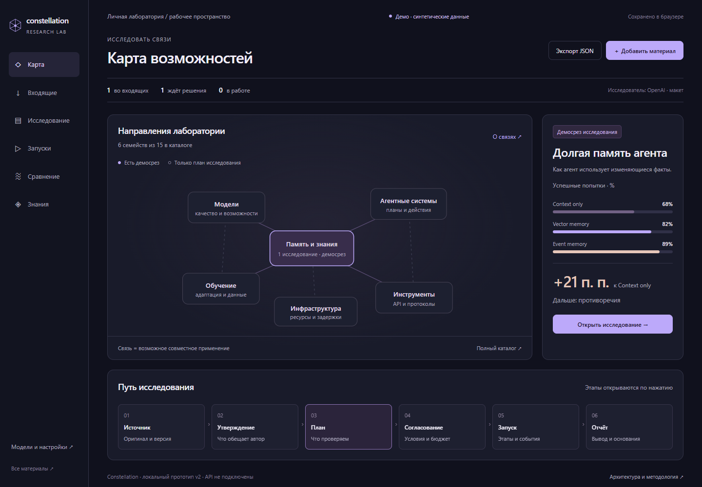

# AI R&D Laboratory

Личная исследовательская лаборатория для оценки новых технологий ИИ: от новости или статьи до воспроизводимого эксперимента, отчёта и решения о применении.

**Статус:** подготовлены архитектура, план приватной альфы, критерии приёмки и интерактивные HTML-прототипы. Backend, подключения к провайдерам и реальные исполнители ещё не реализованы. Все показатели прототипов синтетические.

## Как работает лаборатория

```text
Материал → утверждение → гипотеза → план и оценка затрат
    → подтверждение пользователя → эксперимент
    → измерения и доказательства → сравнение → сохранённое решение
```

Пользователь сохраняет материалы из Telegram, ссылки, тексты, PDF и сведения о проектах. ИИ-исследователь отделяет заявления авторов от доказательств и предлагает проверку. После подтверждения конкретного плана и бюджета лаборатория выполняет эксперимент, сохраняет результаты и показывает пользу, ограничения и стоимость подхода.

Исследователь, испытуемая система и оценщик — отдельные роли. Измерения рассчитываются из результатов исполнения; текст модели не заменяет исходные данные. Сохранённый рецепт можно повторить и использовать для сравнения с последующими технологиями.

## Документация

| Материал | Содержание |
| --- | --- |
| [Навигатор проектного пакета](deliverables/index.html) | Все документы и три первоначальные UI-концепции |
| [Архитектура C4](deliverables/docs/architecture.html) | Контекст, контейнеры, компоненты, контракты, интеграции и развёртывание |
| [План реализации](deliverables/docs/implementation-plan.html) | Этапы P0–P7, цель 4–5 недель, зависимости и критерии G0–G7 |
| [Каталог исследований](deliverables/docs/research-catalog.html) | 15 семейств технологий, 14 типов задач, 9 семейств метрик |
| [Матрица приёмки альфы](deliverables/architecture/alpha-acceptance.json) | 57 требований, проверки, зависимости и ожидаемые доказательства |
| [Доменная модель](deliverables/architecture/domain-model.json) | Сущности, события, состояния и связи |
| [Схема плана эксперимента](deliverables/architecture/experiment-plan.schema.json) | JSON Schema исполняемого контракта |
| [Синтетический пример плана](deliverables/architecture/example-plan.json) | Пример формы контракта; не разрешение на реальный запуск |
| [Первое задание Claude Code](deliverables/docs/claude-task-001.html) | Ограниченная проверка контрактов и отказных сценариев |
| [Проверки проектных материалов](deliverables/qa/verification.html) | Выполненные проверки прототипов и границы их охвата |

HTML-файлы в интерфейсе GitHub доступны как исходники. Для интерактивного просмотра откройте их локально по инструкции ниже. [SVG-схемы и исходники DOT](deliverables/architecture/) хранятся отдельно и доступны без сборки.

## Согласованный интерфейс

**Constellation v2** — основа интерфейса: карта технологий и исследований, входящие материалы, планирование, запуски, сравнения и накопленные знания. Визуальный подход — минимализм, понятные графики и детали по запросу.



[Открыть HTML-прототип](deliverables/ui/03-constellation.html) · [Покрытие функций и изменения v2](deliverables/docs/constellation-ux-review.html) · [Сохранённая версия v1](deliverables/ui/03-constellation-v1.html)

Прототип сохраняет демонстрационное состояние в браузере. Он не подключён к API моделей, не выполняет реальные исследования и не создаёт расходов.

## Что входит в приватную альфу

- Импорт текста, URL, файлов и ручных пересылок в Telegram-бота с сохранением оригинала и происхождения данных.
- ИИ-исследователь, отдельные роли кандидата и оценщика, нативные адаптеры OpenAI и Anthropic.
- Версионируемый план, оценка затрат и подтверждение человеком конкретной версии и бюджета.
- Учёт резервов и расходов, включая неопределённый исход внешнего вызова после таймаута.
- Изолированное исполнение, прогресс, отмена, сохранение частичных результатов и восстановление после сбоев.
- Метрики с явными знаменателями, неопределённостью и ссылками на исходные попытки; проверка сопоставимости результатов.
- Отчёты, экспорт, повтор эксперимента, база знаний, резервные копии и проверенное восстановление.

| Исполняемая методика | Что проверяет |
| --- | --- |
| **DecisionStructure** | Классификация, маршрутизация, извлечение структурированных данных и решение об отказе |
| **MemoryRetrieval** | Поиск, обновление памяти, противоречия и устаревание фактов |
| **ToolUseRecovery** | Работа с инструментами и восстановление после ошибок |

Цель — **4–5 недель от начала реализации**, с пересмотром прогноза по фактической скорости и доступным лимитам. Готовность означает прохождение всех 57 требований матрицы и G0–G7. Подготовленные документы и макет не считаются выполненной реализацией этих требований.

Приглашённые пользователи, дополнительные провайдеры, расширенные GitHub/Hugging Face-интеграции, расписания, GPU, обучение, дополнительные модальности, робототехника и маркетплейс относятся к дальнейшим поставкам. Широкий каталог не означает возможность исполнить любой тип исследования в альфе.

## Архитектурная основа

Предлагаемый стек для будущей реализации:

| Слой | Решение |
| --- | --- |
| Интерфейс | Next.js / React, ECharts, дизайн Constellation |
| Управление исследованиями | Модульный FastAPI API, PostgreSQL |
| Долгие процессы | Temporal, транзакционный outbox и идемпотентные команды |
| Провайдеры | Собственный gateway, нативные адаптеры, контроль полномочий и расходов |
| Исполнение | Inspect и общий command runner, отдельный sandbox / VM |
| Измерения | Python, Polars / DuckDB, версионируемые оценщики |
| Артефакты | Content-addressed storage; локальный или S3-совместимый адаптер |
| Эксплуатация | OpenTelemetry, резервные копии, раздельные секреты и права |

Конкретные версии, окружение sandbox и возможности адаптеров проверяются на этапе P0. Эти сервисы пока не собраны в работающий стенд.

## Локальный просмотр

```sh
git clone https://github.com/VasilyKolbenev/AI-R-D-laboratory.git
cd AI-R-D-laboratory
python -m http.server 8794 --bind 127.0.0.1
```

Откройте [локальный навигатор](http://127.0.0.1:8794/deliverables/index.html). Остановка сервера: `Ctrl+C`. Это сервер статических документов, а не backend лаборатории.

Можно также открыть `deliverables/index.html` напрямую в современном браузере. Для просмотра не нужны Node.js, API-ключи или установка зависимостей. Поведение локального хранилища при открытии файлов зависит от браузера; localhost удобнее для устойчивого сохранения состояния.

## Работа над проектом

**Claude Code** реализует ограниченные задания. **Codex** отвечает за архитектуру, декомпозицию, ревью и приёмку. **Владелец продукта** вручную передаёт задания и отчёты, оценивает полезность и разрешает реальные расходы.

1. Прочитать [CLAUDE.md](CLAUDE.md), архитектуру и актуальное задание.
2. Начать с [TASK-001](deliverables/docs/claude-task-001.html): детерминированный Python spike контрактов, согласования и бюджетного учёта с fake provider.
3. Вернуть изменённые файлы, точные команды и результаты проверок, ограничения и найденные противоречия.
4. Пройти ревью Codex, исправить замечания и только затем переходить к следующему заданию.

TASK-001 не требует сети, ключей или платных вызовов. Реальный пилот лаборатории выполняется после отдельного подтверждения плана и бюджета. Статус требования меняется по проверяемым доказательствам, а не по факту написания кода.

## Проверка и пересборка документации

Для статической проверки нужны Python 3 и зависимости документации:

```sh
python -m pip install -r deliverables/requirements-docs.txt
python deliverables/qa/package-check.py
```

Для пересборки схем и браузерной проверки дополнительно нужны Node.js и Chromium:

```sh
npm --prefix deliverables ci
npm --prefix deliverables exec -- playwright install chromium
npm --prefix deliverables run check:constellation
npm --prefix deliverables run check:alpha-docs
```

Скрипты проверяют прототип и проектные документы; они не подтверждают готовность backend или реальных API. Текущие отчёты содержат SHA-256 проверенных HTML-файлов. После изменения этих файлов сначала обновите соответствующий браузерный отчёт, затем запускайте статическую проверку.

Дополнительные команды:

```sh
python deliverables/build_diagrams.py
npm --prefix deliverables run diagrams
python deliverables/qa/build_report.py
python deliverables/build_package.py
```

ZIP-пакет создаётся локально и не хранится в Git. Исторические проверки первой итерации находятся в `deliverables/qa/`; текущие сценарии Constellation v2 и плана альфы запускаются командами выше.

## Структура репозитория

```text
README.md                       Обзор и начало работы
CLAUDE.md                       Инструкции разработчику
deliverables/
  index.html                    Навигатор документов и прототипов
  docs/                         Архитектура, план, каталог и задания
  architecture/                 DOT, SVG, схемы JSON и матрица приёмки
  ui/                           Согласованный и исходные UI-прототипы
  qa/                           Проверки, отчёты и визуальные снимки
```

Исходный код работающей лаборатории будет добавляться по принятым заданиям. Архитектурные изменения фиксируются отдельно и проходят техническое ревью.
