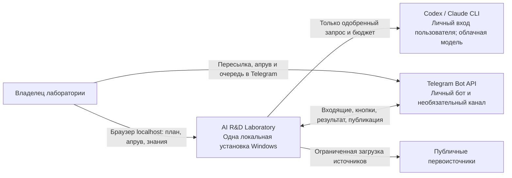
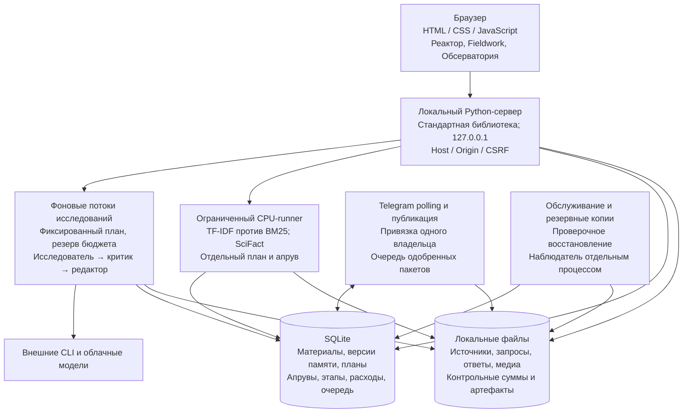

# Архитектура локальной альфы

Это описание работающей версии `0.20.0-alpha.1`. Ранние схемы в
`deliverables/docs/architecture.html` описывают исходный проект и будущие варианты.

## C1 — контекст

Локальный интерфейс работает без исполнителя и бота. Для реального исследования
нужны выбранный облачный исполнитель и отдельное подтверждение плана. Установка,
просмотр страницы и загрузка материала сами по себе не запускают исследование.

## C2 — контейнеры и данные

Сервер, Telegram-поллинг, задания и обслуживание принадлежат одной установке.
SQLite и файловые артефакты хранятся в `.lab-data/`; медиа-кодировщик — в
`.lab-tools/`. Полные копии находятся в `.lab-backups/`. Эти каталоги не входят
в исходники и релизный ZIP. Наблюдатель восстанавливает сервер; он не повторяет
неопределённые модельные вызовы и отправки.

## Границы исполнения

- Апрув связан с точной версией плана и выбранным контекстом. Новый контекст
  требует нового плана и подтверждения.
- Три контекста исполнителя — роли анализа источников. Они не заменяют
  независимый эксперимент исследуемой технологии.
- CPU-runner исполняет только фиксированную методику лексического поиска.
  Универсальный запуск кода из статей и локальные модели не реализованы.
- Публикация требует отдельного «В очередь». Расписание не инициирует
  исследования. Работа зависит от включённого компьютера и доступа в интернет.
- Неизвестный исход внешнего вызова сохраняется как неопределённый расход;
  автоматического платного повтора нет.
- CLI-ограничения являются дополнительной защитой, а не виртуальной машиной.
  Приложение не предоставляет внешнюю многопользовательскую авторизацию или
  изоляцию арендаторов. Сервер предназначен для `localhost`.

Зашифрованные локальные секреты Windows привязаны к профилю пользователя.
Копия на том же диске не защищает от потери диска. Ограничения и восстановление:
[эксплуатация](operations.md), [безопасность](../SECURITY.md).
